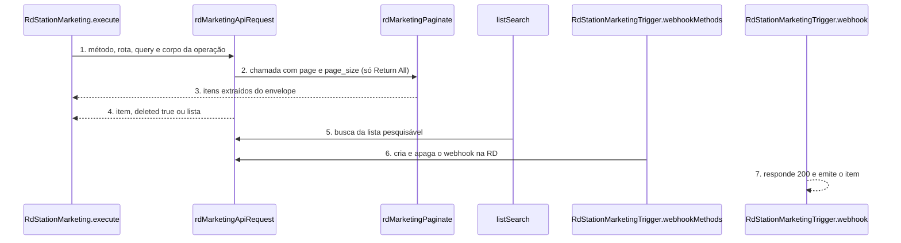
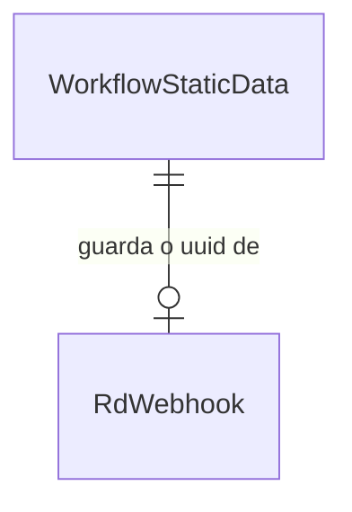

# RD Station Marketing: community node n8n 1.0.0

**Approved**: 2026-11-06 - user: "Aprovo os três (Recomendado · Jev 0,94)"

> Build this with **tlc-implement**. Every criterion becomes a check with a proof; nothing under
> the open questions is settled while building.

## Problem

Hoje quem usa o RD Station Marketing no n8n monta cada chamada à mão no node HTTP Request: cria o app na App Store da RD, faz o fluxo OAuth2 com um formato de token próprio (client id e secret no corpo, refresh em JSON), descobre à mão o identificador de cada segmentação, fluxo, campo personalizado e e-mail, e pagina listas cujo envelope muda a cada rota. Para receber conversões, a pessoa cadastra o webhook no painel ou por `POST` manual e não tem como apagá-lo quando desativa o workflow. O pacote `n8n-nodes-rd-station-crm` só cobre o RD Station CRM, e a guideline de verificação do n8n exige um serviço por pacote. A fonte oficial (developers.rdstation.com) documenta cerca de 45 rotas de dados do Marketing.

Quando isso sair: o pacote `n8n-nodes-rd-station-marketing` 1.0.0 traz um node de ação que cobre todas as rotas não descontinuadas do Marketing, com listas pesquisáveis tiradas da própria conta, e um node gatilho que registra e remove o webhook da RD sozinho ao ativar e desativar o workflow.

## Shape

Reutiliza os helpers e os testes do desenho do pacote Vizard (contexto falso que grava a requisição) e a toolchain do template do `@n8n/node-cli` 0.55.5, sem copiar código do pacote CRM, porque a API do Marketing tem outra base, outro formato de autenticação e outros envelopes. A regra que muda o resultado, extrair os itens do envelope, paginar e montar o corpo de cada evento, fica em funções de `nodes/RdStationMarketing/` chamadas pelo `execute`, que os testes alcançam pelo `execute` do node sobre o `dist`.

1. entra o item do workflow -> `RdStationMarketing.execute` (new) - lê `resource` e `operation`, valida os parâmetros e monta método, rota, query e corpo
2. `rdMarketingApiRequest` (new) - escolhe a credencial pelo seletor de autenticação, aplica base, cabeçalhos e `timeout` de 30000 ms e chama `httpRequestWithAuthentication`; traduz `401`, `429` e `4xx` da RD em `NodeApiError`
3. `rdMarketingPaginate` (new) - nas listagens com Return All, repete a chamada com `page` e `page_size` até vir menos itens que o tamanho da página, e extrai os itens do envelope (array na raiz ou a primeira propriedade que é array, o que cobre a chave `wokflows` grafada errado)
4. out: um item do n8n por registro, ou `{ "deleted": true }` no delete, ou o objeto de resposta nas demais operações
5. o editor do n8n pede opções -> `listSearch` (new) - chama a rota de listagem com o texto de busca e devolve `{ results: [{ name, value }] }`; o `loadOptions` dos campos personalizados e das ações do fluxo usa a mesma rota
6. ativa o workflow -> `RdStationMarketingTrigger.webhookMethods` (new) - `checkExists` procura o `webhookUuid` guardado no static data, `create` chama `POST /integrations/webhooks` com a URL de produção do n8n e grava o `uuid` (door 3), `delete` chama `DELETE /integrations/webhooks/{uuid}` ao desativar
7. a RD envia o evento -> `RdStationMarketingTrigger.webhook` (new) - responde `200` na hora (a RD espera 2xx em 5 s e tenta mais 3 vezes) e emite o corpo como item do workflow

**Changes underneath**

| Front | What changes |
| --- | --- |
| domain | nada existe ainda: pacote novo, sem workflow salvo para migrar |
| stored data | o trigger guarda só o `uuid` do webhook da RD no static data do workflow (door 3); nada mais é gravado |
| readers | o editor do n8n lê o `listSearch` e o `loadOptions`; o painel do RD Marketing não mostra webhooks criados por API |

New: `WorkflowStaticData` guarda no máximo um `RdWebhook` por node gatilho. One-way constraints: a chave `webhookUuid` do static data (door 3).

## Surface

| Route | In | Out | Status | Who |
| --- | --- | --- | --- | --- |
| node `rdStationMarketing` | `resource`, `operation`, `authentication`, campos da operação | um item por registro; `{ "deleted": true }` no delete; objeto da RD nas demais | `200`; `400` e `422` da RD viram `NodeApiError`; `401` com credencial inválida; `429` com o tempo de espera | quem tem credencial RD válida; sem ela a RD devolve `401` |
| node `rdStationMarketingTrigger` webhook | corpo JSON da RD com `event_type`, `event_identifier`, `contact` | `200` vazio e um item no workflow | `200`; `404` quando o workflow está desativado | anyone que conhece a URL do webhook; a RD não assina o corpo |
| `listSearch` e `loadOptions` | texto de busca e página | `{ results: [{ name, value }] }` ou lista de opções | `200`; `401` da RD com credencial inválida vira `NodeApiError` | o editor do n8n com credencial RD válida; sem ela a RD devolve `401` |
| teste da credencial | token de acesso | resposta de `GET /platform/contacts/fields` | `200`; `401` com token inválido | quem salva a credencial no n8n; token inválido recebe `401` |

## Landing

| One-way door | Literal shape | Alternative rejected |
| --- | --- | --- |
| nomes persistidos nos workflows | pacote `n8n-nodes-rd-station-marketing`; nodes `rdStationMarketing` e `rdStationMarketingTrigger`; credenciais `rdStationMarketingOAuth2Api` e `rdStationMarketingApi`; `version: 1`; parâmetros `resource`, `operation`, `authentication`, `returnAll`, `limit` | prefixo `rdMarketing`: não bate com o nome do pacote e do repositório |
| forma dos IDs | todo ID que tem rota de listagem é `resourceLocator` com modos `list` (padrão, `searchable: true`) e `id`, e o valor lido é o texto do `value` | campo de texto puro: a UX guideline do n8n manda `From list` como padrão, e trocar o tipo depois quebra workflows salvos |
| saída das listagens | um item do n8n por registro, sem o envelope da RD; nas 4 operações de Analytics, um item por linha do array principal | devolver o envelope cru: obriga o usuário a um node Split Out em toda listagem |
| static data do trigger | chave `webhookUuid` no static data do node gatilho (`getWorkflowStaticData('node')`) | guardar na URL do webhook: a RD não devolve a URL no `checkExists` de forma confiável, e o `uuid` é o único dado que o `DELETE` aceita |
| credencial OAuth2 | `extends = ['oAuth2Api']`, `grantType: authorizationCode`, `authentication: body`, sem `scope`, token em `https://api.rd.services/auth/token?token_by=code` | tipo de credencial próprio com `preAuthentication`: perde o fluxo de login pronto do n8n; decisão AD-004 |
| dependências | `package.json` sem `dependencies`; só `devDependencies` do template | biblioteca HTTP externa: a guideline de verificação do n8n proíbe |

- Nothing else in this change is hard to reverse

## Criteria

### S1: pacote, toolchain e entrega (P1)

O repositório compila, passa no lint oficial, roda os testes e publica no npm com provenance.

**Acceptance Criteria**

1. WHEN `npm run build` roda THEN o sistema SHALL sair com código 0 e gerar o node de ação, o gatilho, as duas credenciais e os ícones `.svg` ao lado de cada node em `dist/`
2. WHEN `npm run lint` roda THEN `n8n-node lint` SHALL sair com código 0 e imprimir 0 erros
3. The `package.json` SHALL ter `"name": "n8n-nodes-rd-station-marketing"`, `"version": "1.0.0"`, `"license": "MIT"`, a keyword `n8n-community-node-package`, `"build": "n8n-node build"`, `"lint": "n8n-node lint"`, `"n8n.strict": true`, `@n8n/node-cli` `0.55.5` em `devDependencies`, `n8n.nodes` com 2 entradas, `n8n.credentials` com 2 entradas e nenhum campo `dependencies`
4. WHEN `npm test` roda THEN o sistema SHALL compilar e rodar `node --test test/*.test.cjs` com saída `# fail 0`
5. WHEN um Pull Request abre THEN o workflow de CI SHALL rodar `npm ci`, `npm run lint`, `npm test` e `npm run build`
6. WHEN uma tag `v1.0.0` chega ao GitHub THEN o workflow de publicação SHALL conferir que a tag é igual à versão do `package.json`, rodar lint, teste e build, e publicar com provenance, e `npm view n8n-nodes-rd-station-marketing version` SHALL devolver `1.0.0`
7. IF um arquivo `.ts` em `nodes/` ou `credentials/` não abre com um bloco de comentário `/**` em PT-BR THEN o teste `comentarios.test.cjs` SHALL falhar com o nome do arquivo
   - arquivo com cabeçalho `/**` → passa; arquivo que abre com `import` → falha nomeando o arquivo
8. The `README.md` SHALL estar em PT-BR com as seções do README do pacote CRM (instalação, credenciais, recursos e operações, exemplos, desenvolvimento), e o `CHANGELOG.md` SHALL ter a seção `## 1.0.0`

### S2: credenciais e transporte (P1)

As duas credenciais autenticam, e toda chamada sai com o mesmo cuidado de timeout e de erro.

**Acceptance Criteria**

1. The credencial `rdStationMarketingOAuth2Api` SHALL estender `oAuth2Api` com `grantType` `authorizationCode`, `authUrl` https://api.rd.services/auth/dialog, `accessTokenUrl` https://api.rd.services/auth/token?token_by=code e `authentication` `body`
2. The credencial `rdStationMarketingApi` SHALL ter o campo `apiKey` com `typeOptions.password` verdadeiro
3. WHEN o `execute` roda THEN toda requisição SHALL levar `timeout` 30000 e a base https://api.rd.services com cabeçalho `Content-Type: application/json`
4. WHEN a operação de evento escolhe `authentication` `apiKey` THEN o sistema SHALL chamar POST /platform/conversions com `api_key` na query e sem cabeçalho `Authorization`; WHEN escolhe `oAuth2` THEN SHALL chamar POST /platform/events com a credencial OAuth2
5. WHILE a operação não é Send Conversion o node SHALL esconder o seletor `authentication` e usar só a credencial OAuth2
6. IF a RD devolve `401` THEN o sistema SHALL lançar `NodeApiError` com a mensagem `Your RD Station access token is invalid or expired [item 0]` e a descrição `Reconnect the RD Station credential and run the node again`
7. IF a RD devolve `429` com `remaining_time` 43067 THEN o sistema SHALL lançar `NodeApiError` com a mensagem `The RD Station rate limit was reached [item 0]` e a descrição `Wait 44 seconds and run the node again`
   - 43067 ms → 44 s; 1000 ms → 1 s; sem `remaining_time` → `Wait a few minutes and run the node again`
8. IF a RD devolve `400` com `errors.email[0].error_type` `CANNOT_BE_NULL` THEN o sistema SHALL lançar `NodeApiError` com a mensagem `RD Station rejected the 'email' field: CANNOT_BE_NULL [item 0]`
9. WHEN `Continue On Fail` está ligado e o item 1 falha THEN o sistema SHALL devolver `{ "error": "<mensagem>" }` no item 1 e processar o item 2

### S3: contatos (P1)

Criar, ler, atualizar, apagar e etiquetar contatos, e ler os eventos de um contato.

**Acceptance Criteria**

1. WHEN alguém roda Contact → Get com `identifierType` `email` e `identifier` `foo@bar.com` THEN o sistema SHALL chamar GET /platform/contacts/email:foo@bar.com e devolver 1 item com `uuid`, `name`, `email`
2. WHEN alguém roda Contact → Create com `email` `ana@example.com` e `name` `Ana` THEN o sistema SHALL chamar POST /platform/contacts com corpo `{ "email": "ana@example.com", "name": "Ana" }`
3. IF Contact → Create chega sem `email` e sem `phone` THEN o sistema SHALL lançar `NodeOperationError` com a mensagem `Provide an email or a phone [item 0]` e a descrição `The contact needs at least one of them to be created`, sem chamar a RD
4. WHEN alguém roda Contact → Update com `identifierType` `email` THEN o sistema SHALL chamar PATCH /platform/contacts/email:<valor> sem o campo `email` no corpo
   - identificador `uuid` com `email` novo no corpo → o corpo leva o `email`; identificador `email` → o corpo não leva `email`
5. WHEN Contact → Update recebe `tags` `a, b` THEN o sistema SHALL enviar `"tags": ["a", "b"]` e a descrição do campo SHALL dizer `Replaces all existing tags`
6. WHEN alguém roda Contact → Delete THEN o sistema SHALL chamar DELETE /platform/contacts/<identificador>:<valor> e devolver 1 item `{ "deleted": true }` mesmo com a RD respondendo `204` sem corpo
7. WHEN alguém roda Contact → Add Tags com `tags` `Primeiro contato` THEN o sistema SHALL chamar POST /platform/contacts/<identificador>:<valor>/tag com `{ "tags": ["Primeiro contato"] }`
8. WHEN alguém roda Contact → Get Events com `eventType` `CONVERSION` e Return All ligado THEN o sistema SHALL chamar GET /platform/contacts/<uuid>/events com `event_type=CONVERSION` e `page` 1, 2, 3 até vir uma página vazia
9. WHEN alguém preenche Custom Fields em Contact → Create ou Update com o campo `cf_plano` valor `Pro` THEN o sistema SHALL enviar `"cf_plano": "Pro"` no corpo
10. WHERE `Simplify` está ligado em Contact → Get o sistema SHALL devolver só `uuid`, `name`, `email`, `phone`, `job_title`, `city`, `state`, `country`, `tags`, `website`
11. IF a RD devolve `404` em Contact → Get THEN o sistema SHALL lançar `NodeApiError` com a mensagem `The contact was not found [item 0]` e a descrição `Check the identifier type and the value, then run the node again`

### S4: campos personalizados (P1)

Listar, criar, editar e apagar campos personalizados, e usá-los em dropdowns.

**Acceptance Criteria**

1. WHEN alguém roda Custom Field → Get Many com Return All THEN o sistema SHALL chamar GET /platform/contacts/fields uma vez e devolver 1 item por campo, sem enviar `page`
2. WHEN alguém roda Custom Field → Get Many com Limit 10 e a RD devolve 25 campos THEN o sistema SHALL devolver 10 itens
3. WHEN alguém roda Custom Field → Create com `api_identifier` `cf_plano`, `data_type` `STRING`, `name` `Plano`, `label` `Plano` e `presentation_type` `TEXT_INPUT` THEN o sistema SHALL chamar POST /platform/contacts/fields com `"name": { "pt-BR": "Plano" }` e `"label": { "pt-BR": "Plano" }`
4. IF o `api_identifier` não começa com `cf_` THEN o sistema SHALL lançar `NodeOperationError` com a mensagem `The 'API Identifier' must start with 'cf_' [item 0]`, sem chamar a RD
5. WHEN alguém roda Custom Field → Update com o campo escolhido na lista THEN o sistema SHALL chamar PATCH /platform/contacts/fields/<uuid> sem `api_identifier` no corpo
6. WHEN alguém roda Custom Field → Delete THEN o sistema SHALL chamar DELETE /platform/contacts/fields/<uuid> e devolver `{ "deleted": true }`
7. WHEN o editor abre o dropdown Custom Field THEN o `loadOptions` SHALL chamar GET /platform/contacts/fields, manter só `custom_field` verdadeiro e devolver `{ name: label["pt-BR"], value: api_identifier }`
   - campo padrão `email` (`custom_field` falso) → fora da lista; `cf_plano` → na lista

### S5: funil do contato (P1)

Ler e mudar o estágio, a oportunidade e o dono do contato no funil padrão.

**Acceptance Criteria**

1. WHEN alguém roda Funnel → Get THEN o sistema SHALL chamar GET /platform/contacts/<identificador>:<valor>/funnels/default e devolver `lifecycle_stage`, `opportunity`, `contact_owner_email`, `fit`, `interest`
2. WHEN alguém roda Funnel → Update com `lifecycleStage` `Qualified Lead` e `opportunity` verdadeiro THEN o sistema SHALL chamar PUT na mesma rota com `{ "lifecycle_stage": "Qualified Lead", "opportunity": true }`
3. The dropdown `lifecycleStage` SHALL ter exatamente `Lead`, `Qualified Lead` e `Client`
4. WHEN `removeContactOwner` está ligado THEN o sistema SHALL enviar `"contact_owner_email": null`; WHEN está desligado e o campo está vazio THEN SHALL omitir o campo

### S6: segmentações e fluxos de automação (P1)

Listar segmentações e seus contatos, e operar os fluxos de automação.

**Acceptance Criteria**

1. WHEN alguém roda Segmentation → Get Many com Return All THEN o sistema SHALL chamar GET /platform/segmentations com `page_size` 125 e `page` 1, 2, ... até vir uma página com menos de 125 itens
   - 125 itens na página 1 e 40 na página 2 → 165 itens e 2 chamadas; 125 e 0 → 125 itens e 2 chamadas
2. WHEN alguém roda Segmentation → Get Contacts com a segmentação escolhida na lista THEN o sistema SHALL chamar GET /platform/segmentations/<id>/contacts e devolver 1 item por contato
3. WHEN o editor pede a lista de segmentações com a busca `leads` THEN o `listSearch` SHALL chamar GET /platform/segmentations com `search=leads` e devolver `{ name, value: id }`; WHEN a busca está vazia THEN SHALL incluir as segmentações padrão de id 1 a 5
4. WHEN alguém roda Automation Flow → Get Many THEN o sistema SHALL chamar GET /platform/workflows e extrair os itens da chave `wokflows` mesmo grafada errado
5. WHEN alguém roda Automation Flow → Get com o fluxo escolhido na lista THEN o sistema SHALL chamar GET /platform/workflows/<id> e devolver o conteúdo de `workflow_info`
6. WHEN alguém roda Automation Flow → Add Leads com `leads` `a@example.com, +5511987654321` THEN o sistema SHALL chamar POST /platform/workflows/<id>/leads com `{ "leads": ["a@example.com", "+5511987654321"] }` e devolver `leads_added` e `leads_not_found`
7. WHEN alguém roda Automation Flow → Get Leads Started com `startDate` `2026-11-01` e `endDate` `2026-11-05` THEN o sistema SHALL chamar GET /platform/workflows/<id>/leads/started com essas datas e devolver 1 item por lead; as operações Left e Action Executed SHALL chamar `/leads/left` e `/leads/action/<action_id>` com os mesmos parâmetros
8. IF `endDate` é anterior a `startDate` THEN o sistema SHALL lançar `NodeOperationError` com a mensagem `The 'End Date' is before the 'Start Date' [item 0]`, sem chamar a RD
9. WHEN o editor abre o dropdown Action no fluxo escolhido THEN o `loadOptions` SHALL chamar GET /platform/workflows/<id> e devolver `{ name: type, value: id }` de cada item de `actions`

### S7: e-mails, páginas, formulários e campanhas (P2)

Ler os ativos de marketing da conta e as campanhas.

**Acceptance Criteria**

1. WHEN alguém roda Email → Get Many com a busca `boas-vindas` THEN o sistema SHALL chamar GET /platform/emails com `query=boas-vindas` e devolver 1 item por elemento de `items`
2. WHEN alguém roda Email → Get com o e-mail escolhido na lista THEN o sistema SHALL chamar GET /platform/emails/<id>
3. WHEN alguém roda Landing Page → Get Many, Pop-up → Get Many ou Form → Get Many THEN o sistema SHALL chamar GET /platform/landing_pages, GET /platform/popups e GET /platform/embeddables, nessa ordem, com `page` e `page_size`
4. WHEN alguém roda Campaign → Get Many com Return All THEN o sistema SHALL chamar GET /platform/campaigns com `page_size` 50 e paginar até vir menos de 50 itens
5. WHEN alguém roda Campaign → Get e Campaign → Get Items com a campanha escolhida na lista THEN o sistema SHALL chamar GET /platform/campaigns/<id> e GET /platform/campaigns/<id>/items, e devolver o conteúdo de `campaign` ou 1 item por elemento de `items`
6. WHEN Campaign → Get Items recebe `itemType` `email` THEN o sistema SHALL enviar `item_type=email` na query
7. IF a RD devolve `403` ou `404` em Campaign → Get Many (recurso só dos planos Pro e Advanced) THEN o sistema SHALL lançar `NodeApiError` com a descrição `This feature may need the Pro or Advanced plan of RD Station Marketing`

### S8: analytics (P2)

Ler os quatro relatórios da conta, um item por linha.

**Acceptance Criteria**

1. WHEN alguém roda Analytics → Get Emails com `startDate` `2026-10-01` e `endDate` `2026-10-31` THEN o sistema SHALL chamar GET /platform/analytics/emails com essas datas e devolver 1 item por elemento de `emails`
2. WHEN alguém roda Analytics → Get Workflow Emails, Get Funnel e Get Conversions THEN o sistema SHALL chamar GET /platform/analytics/workflow_emails, /platform/analytics/funnel e /platform/analytics/conversions e devolver 1 item por elemento de `workflow_email_statistics`, `funnel` e `conversions`
3. WHEN Analytics → Get Funnel recebe `groupedBy` `weekly` THEN o sistema SHALL enviar `grouped_by=weekly`; WHEN o campo fica no padrão THEN SHALL enviar `grouped_by=daily`
4. WHEN Analytics → Get Conversions recebe `assetsType` `LandingPage` e `Popup` THEN o sistema SHALL enviar `assets_type[]=LandingPage&assets_type[]=Popup`
5. IF `endDate` é anterior a `startDate` THEN o sistema SHALL lançar `NodeOperationError` com a mensagem `The 'End Date' is before the 'Start Date' [item 0]`, sem chamar a RD

### S9: eventos (P1)

Enviar conversões, qualificação e eventos de chat, ligação, mídia e e-commerce.

**Acceptance Criteria**

1. WHEN alguém roda Event → Send Conversion com `conversionIdentifier` `newsletter` e `email` `ana@example.com` THEN o sistema SHALL enviar `{ "event_type": "CONVERSION", "event_family": "CDP", "payload": { "conversion_identifier": "newsletter", "email": "ana@example.com" } }` e devolver `{ "event_uuid": "<uuid>" }`
2. IF Send Conversion chega sem `email` e sem `phone` THEN o sistema SHALL lançar `NodeOperationError` com a mensagem `Provide an email or a phone [item 0]`, sem chamar a RD
3. WHEN Send Conversion recebe o campo personalizado `cf_plano` valor `Pro` em Custom Fields THEN o sistema SHALL enviar `"cf_plano": "Pro"` dentro de `payload`
4. WHEN alguém roda Event → Mark Opportunity THEN o sistema SHALL enviar `event_type` `OPPORTUNITY` com `payload` `{ "email": "...", "funnel_name": "default" }`
5. WHEN alguém roda Event → Mark Sale com `value` 1500 THEN o sistema SHALL enviar `event_type` `SALE` e `"value": 1500` no `payload`; WHEN `value` fica vazio THEN SHALL omitir o campo
6. WHEN alguém roda Event → Mark Lost Opportunity com `reason` `Sem orçamento` THEN o sistema SHALL enviar `event_type` `OPPORTUNITY_LOST` e `"reason": "Sem orçamento"`
7. IF Mark Lost Opportunity chega com `reason` vazio THEN o sistema SHALL lançar `NodeOperationError` com a mensagem `The 'Reason' parameter is empty [item 0]`, sem chamar a RD
8. WHEN alguém roda Event → Send Chat Event com `chatEvent` `Started`, `chatSubject` `Dúvida` e `chatStatus` `online` THEN o sistema SHALL enviar `event_type` `CHAT_STARTED` com `chat_subject` e `cf_chat_status` `online`; com `Finished` SHALL enviar `CHAT_FINISHED` e exigir `cf_chat_transcript_message`
9. WHEN alguém roda Event → Send Call Finished com `callFromNumber` e `callStatus` THEN o sistema SHALL enviar `event_type` `CALL_FINISHED` com `call_from_number` e `call_status`
10. WHEN alguém roda Event → Send Media Event com `mediaEvent` `Stopped` THEN o sistema SHALL enviar `event_type` `MEDIA_PLAYBACK_STOPPED` com `media_type` e `media_identifier`
11. WHEN alguém roda Event → Send Custom Event com `eventType` `ECOMMERCE_ORDER_PLACED` e `payload` em JSON THEN o sistema SHALL enviar esse `event_type` e esse `payload` com `event_family` `CDP`
    - o dropdown `eventType` lista os 8 tipos `ECOMMERCE_*` e nenhum tipo descontinuado
12. WHEN alguém roda Event → Send Batch com `events` em JSON de 3 eventos THEN o sistema SHALL chamar POST /platform/events/batch com o array e devolver `event_batch_uuid` e `events`
13. IF o corpo de Send Batch passa de 200000 bytes THEN o sistema SHALL lançar `NodeOperationError` com a mensagem `The batch is larger than 0.2 MB [item 0]` e a descrição `Split the events into smaller batches`, sem chamar a RD
14. IF um JSON de Send Custom Event ou Send Batch não é válido THEN o sistema SHALL lançar `NodeOperationError` com a mensagem `The 'Payload' parameter is not valid JSON [item 0]`

### S10: catálogo de produtos e webhooks (P2)

Gerenciar catálogos de produtos e webhooks pelo node de ação.

**Acceptance Criteria**

1. WHEN alguém roda Product Catalog → Create com `name` `Loja`, `url` https://example.com/feed.json e `format` `json` THEN o sistema SHALL chamar POST /platform/catalog_feeds com esses três campos e SHALL omitir `username` e `password` vazios
2. WHEN alguém roda Product Catalog → Get, Get Many, Update e Delete THEN o sistema SHALL chamar GET, GET, PATCH e DELETE em /platform/catalog_feeds[/<id>], com o catálogo escolhido na lista, e o Delete SHALL devolver `{ "deleted": true }`
3. The dropdown `format` do catálogo SHALL ter exatamente `xml`, `json` e `google_shopping`
4. WHEN alguém roda Webhook → Create com `eventType` `WEBHOOK.CONVERTED`, `url` https://n8n.example.com/webhook/abc e `eventIdentifiers` `newsletter` THEN o sistema SHALL chamar POST /integrations/webhooks com `entity_type` `CONTACT`, `http_method` `POST` e `event_identifiers` `["newsletter"]`
5. WHEN `eventType` é `WEBHOOK.MARKED_OPPORTUNITY` THEN o sistema SHALL esconder `eventIdentifiers` e SHALL omitir `event_identifiers` do corpo
6. WHEN alguém roda Webhook → Get, Get Many, Update e Delete THEN o sistema SHALL chamar GET, GET, PUT e DELETE em /integrations/webhooks[/<uuid>], com o webhook escolhido na lista, e o Delete SHALL devolver `{ "deleted": true }`
7. The dropdown `eventType` do node de ação SHALL ter só os 2 eventos do Marketing e SHALL NOT ter os eventos `crm_deal_*`

### S11: gatilho de webhook (P1)

O workflow ativo recebe as conversões e as oportunidades da RD sem cadastro manual.

**Acceptance Criteria**

1. WHEN o workflow é ativado com `event` `Converted` THEN o sistema SHALL chamar POST /integrations/webhooks com `event_type` `WEBHOOK.CONVERTED`, `entity_type` `CONTACT`, `http_method` `POST` e `url` igual à URL de produção do node, e gravar o `uuid` devolvido em `webhookUuid` no static data
2. WHEN o workflow é ativado com `event` `Marked as Opportunity` THEN o sistema SHALL enviar `event_type` `WEBHOOK.MARKED_OPPORTUNITY` e SHALL omitir `event_identifiers`
3. WHERE `conversionIdentifiers` `newsletter, landing-1` está preenchido e o evento é `Converted` o sistema SHALL enviar `"event_identifiers": ["newsletter", "landing-1"]`
4. WHERE `includeRelations` tem `Company` e `Contact Funnel` o sistema SHALL enviar `"include_relations": ["COMPANY", "CONTACT_FUNNEL"]`
5. WHEN o workflow é ativado e o static data já tem `webhookUuid` que a RD ainda lista THEN o `checkExists` SHALL devolver verdadeiro e o sistema SHALL NOT criar um segundo webhook
6. WHEN o workflow é desativado THEN o sistema SHALL chamar DELETE /integrations/webhooks/<webhookUuid> e apagar `webhookUuid` do static data
   - a RD responde `404` ao DELETE → o sistema trata como apagado e limpa o `webhookUuid`; a RD responde `500` → o sistema lança `NodeApiError`
7. IF a RD recusa a criação com `INVALID_URL` THEN o sistema SHALL lançar `NodeApiError` com a descrição `RD Station only accepts public HTTPS URLs that answer with a 2xx status`
8. WHEN a RD envia um corpo com `event_type` `WEBHOOK.CONVERTED` THEN o sistema SHALL responder `200` e emitir 1 item com o corpo completo, incluindo `contact.uuid` e `event_timestamp`
9. IF o corpo não tem `event_type` (validação inicial da RD na criação) THEN o sistema SHALL responder `200` e SHALL NOT emitir item

## Out of scope

| Excluded | Why |
| --- | --- |
| Eventos de e-commerce descontinuados `ORDER_PLACED`, `ORDER_PLACED_ITEM`, `CART_ABANDONED`, `CART_ABANDONED_ITEM` | A RD os aceitava até 31/12/2025 e hoje é 06/11/2026; os eventos `ECOMMERCE_*` novos ficam cobertos (AD-007) |
| Rota de revogar token `POST /auth/revoke` | O n8n não tem ponto de extensão para revogar ao apagar a credencial; a pessoa revoga na App Store da RD |
| Eventos de webhook `crm_deal_created`, `crm_deal_updated`, `crm_deal_deleted` | São do RD Station CRM e ficam no pacote CRM (AD-001) |
| RD Station Conversas | API separada (Tallos, token JWT), pacote próprio (AD-001) |
| Listar ou buscar contatos | A RD não documenta rota de listagem de contatos; o contato entra por `uuid`, e-mail ou telefone |
| Dropdown de tags e de donos do contato | A RD não documenta rota para listar tags nem usuários; `tags` e `contact_owner_email` ficam como texto |
| Verificar assinatura do corpo do webhook | Nenhuma página da RD menciona assinatura ou HMAC no webhook do Marketing |
| Modo `Output` (Simplified, Raw, Selected fields) para uso como ferramenta de IA | A UX guideline o pede só em nodes de ferramenta com mais de 10 campos; o pedido não o pediu, e `Simplify` cobre o caso do contato |
| Filtro e ordenação extras além dos parâmetros documentados da RD | O pedido é cobrir as rotas, não criar filtros que a RD não tem |

## Assumptions

| Assumption | Chosen default | Rationale | Confirmed? |
| --- | --- | --- | --- |
| Renovação do token OAuth2 | O refresh usa o fluxo padrão de `oAuth2Api` do n8n (door 5) | A RD documenta refresh em JSON com `client_id`, `client_secret` e `refresh_token` sem `grant_type`; não está confirmado que o n8n consegue renovar nesse formato. Testar com conta real antes da tag `v1.0.0`; se falhar, abrir novo plano para uma credencial com `preAuthentication` | n |
| Escopo OAuth | A credencial não envia `scope` | A página de autorização não pede `scope`, embora o OpenAPI cite `rdsmapi_auth` | n |
| Campos `cf_*` em Contact → Create e Update | O node envia `cf_<api_identifier>` no corpo | A página só mostra `cf_*` em conversões e no payload do webhook; se a RD recusar, o erro dela chega ao usuário | n |
| Valor do campo personalizado | Texto livre | A lista `validation_rules.valid_options` existe, mas o tipo de dado muda por campo; uma lista dependente fica para uma versão 1.1 | n |
| Idioma de `name` e `label` ao criar campo personalizado | Chave `pt-BR` | Todos os exemplos da RD usam só `pt-BR` | n |
| Envelope das listas de landing pages, pop-ups, formulários e eventos do contato | Aceita array na raiz ou a primeira propriedade que é array | A doc mostra só o item; a função de extração cobre os dois formatos | n |
| Tamanho de página sem máximo documentado (fluxos, e-mails, páginas, pop-ups, formulários) | `page_size` 50; fluxos com leads usam 25, o máximo do plano mais baixo | A RD só documenta máximo para segmentações (125), campanhas (50) e leads de fluxo por plano | n |
| Eventos do contato (`GET /platform/contacts/{uuid}/events`) | Return All repete `page` até a página vir vazia | A página não documenta total nem tamanho de página (10 por padrão) | n |
| Timeout das requisições | 30000 ms | A regra da casa exige timeout; a RD não documenta o p99 das rotas | n |
| Corpo da validação inicial do webhook | Qualquer corpo sem `event_type` recebe `200` e não emite item | A RD só diz que a URL precisa responder 2xx; o formato do teste não está documentado | n |
| Webhook duplicado | Se a RD recusar por URL já usada no mesmo `event_type`, o erro da RD chega ao usuário | A doc proíbe URL duplicada por `event_type` e manda usar `PUT`; a URL de produção do n8n é única por node | n |
| Retentativas da RD (3 vezes após timeout de 5 s) | O trigger não deduplica; a documentação do README orienta usar `contact.uuid` e `event_timestamp` como chave | O payload do Marketing não traz id de entrega | n |
| `Simplify` em Contact → Get | Desligado por padrão | Desligado preserva todos os campos para quem consome a saída; a UX guideline pede o parâmetro, não o padrão | n |
| Comentário linha a linha em PT-BR | O teste cobre só o cabeçalho de cada `.ts`; o resto é conferido na revisão do código | Um teste não prova o porquê de cada linha | n |
| Rótulos e mensagens do node | Inglês, rótulos em Title Case, placeholders `e.g. ...`, mensagens no formato da UX guideline | O resto do n8n e a UX guideline usam inglês | n |

**Open questions:** none - all resolved or logged above.

## Differences from the source

None - the product matches the source

## Sources

- Pedido do dono, 06/11/2026: pacote próprio `n8n-nodes-rd-station-marketing`, node de ação e gatilho, OAuth2 mais chave de API só na conversão, cobrir todas as rotas não descontinuadas - binding - escopo do trabalho
- Catálogo da API em developers.rdstation.com (coleta de 06/11/2026), seções 1 a 8 - binding - rotas, corpos, limites e lacunas
- Template e guias `.agents/` do `@n8n/node-cli` 0.55.5 (`workflow.md`, `credentials.md`, `nodes-programmatic.md`, `versioning.md`) - binding - toolchain e estilo programático
- n8n UX guidelines (`ux-guidelines.md` no repositório `n8n-io/n8n-docs`) - binding - `From list` como padrão, Title Case, mensagens de erro, delete e Simplify
- Pacotes `Rd Station Node` (README e plano `node-cli-campos-v2`) e `Vizard Node` (testes e workflows) - binding - estilo de README, de plano, de teste e de CI
